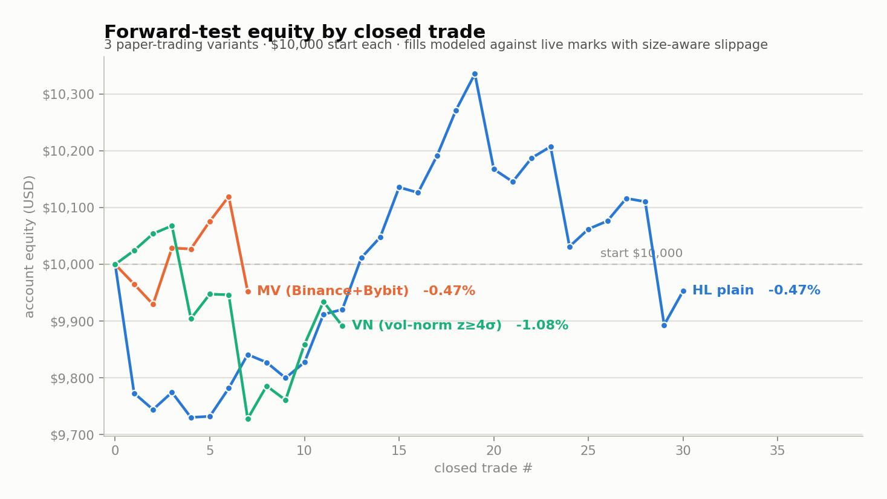

# crypto-momentum-reversion

A research project that tests one specific market-microstructure edge end to end:
**thin-liquidity crypto perpetuals that pump violently tend to mean-revert, so
short the exhaustion and scale out of the drop.** It goes from a hypothesis, to a
survivorship-free backtest with realistic slippage, to **three parallel live
paper-traders** that forward-test the edge (and an ablation of it) against
real-time exchange data.

The headline result is deliberately an honest one, not a cherry-picked equity
curve — see [Results](#results). The point of the project is the *method*:
how you decide whether a pattern is a tradeable edge or a hindsight artifact.

*Why I built this: I kept noticing low-float perps round-tripping their pumps and
wanted to know whether that was a real, tradeable edge or just hindsight — and to
practice evaluating it the way a desk would: survivorship-free, slippage-honest,
and validated out-of-sample before a dollar is at risk.*

> **Not financial advice. Paper trading only.** Every fill in this repo is
> simulated against live public market data. No real orders are placed and no
> API keys are required.

---

## The thesis

Low-float perps that go parabolic (a crowd piling into a narrative) routinely
round-trip the move once the marginal buyer is exhausted. The trade:

- **Entry (short):** a coin whose price rose **≥ 30% within the last 4 hours** — a
  *fast* parabolic move, not a slow grind. (The backtest found the 4h window beat
  a 6h window on out-of-sample return, slippage cushion, *and* breadth.)
- **Exit (scale-out in thirds):** bank ⅓ once price falls **10%**, another ⅓ at
  **25%**, and trail the final ⅓ with a **5% stop off the low**. Hard stop at
  **+30%** adverse (the short going against you), and a **12h** max hold.
- **Sizing:** 5% of equity per position, up to 5 concurrent, 2h per-symbol
  cooldown.

This is explicitly a **greater-fool / short-volatility** trade: a high win-rate
with a fat left tail. The exit ladder matters more than the entry.

---

## What's in here

| File | Role |
|------|------|
| `paper_short.py` | **The strategy.** Live paper-trader on the Hyperliquid perp universe + single source of truth for all parameters, the volume-scaled slippage model, and the scale-out exit logic. |
| `paper_short_mv.py` | Same strategy, **multi-venue** (Binance + Bybit thin-tail universe) — tests whether the edge ports off Hyperliquid. |
| `paper_short_vn.py` | Same strategy, **vol-normalized entry filter** (only take pumps ≥ 4σ of the coin's own trailing 4h-return volatility) — an **ablation** to see if a "smarter" entry gate helps. |
| `paper_trade.py` | Shared Hyperliquid helpers (`_post` / `_market` / `_atr_pct`) and the original long-only paper-trader these were factored out of. |
| `tick_once*.py` | Thin one-shot runners for each trader, meant to be driven by a scheduler (cron / Task Scheduler) every ~2 min. |
| `hl_scan.py` | Standalone Hyperliquid scanner: new listings, funding extremes, volume/OI surges. How candidates are found. |
| `hl_backtest.py` / `hl_backtest_short.py` | The backtest that validated the short edge across the full HL universe, with realistic slippage and scale-out replay. |
| `results/` | Committed snapshots of the three live ledgers (closed trades + equity). The numbers in [Results](#results) come straight from these. |

Everything is **pure Python standard library** (`urllib`, `json`, `statistics`) —
no `pip install`, no third-party dependencies, no exchange keys.

---

## How the edge was pressure-tested

The design choices here are the actual content of the project:

- **Survivorship-free universe.** The backtest replays *every* coin that would
  have triggered the signal — dead and delisted names included — not the handful
  that happened to work. A pattern that only looks good on survivors is a
  hindsight fit.
- **Realistic, size-aware slippage.** Fills model a volume-scaled slippage curve
  (0.05% on liquid names up to a **5% cap** on the thinnest), plus taker fees and
  an **extra 1.5% adverse slip on stop-outs** — because the "burst" on a low-cap
  short is often a single candle with no exit liquidity. Honest slippage is what
  separates a backtest edge from a real one.
- **Out-of-sample + regime split.** Parameters (the 4h window, the exit ladder)
  were chosen on one slice and judged on another, not fit to the whole sample.
- **Forward test, live.** Backtests overfit; the only real validation is
  out-of-time. Three variants run continuously against live marks and log every
  trade to an append-only ledger.
- **A real ablation.** `paper_short_vn` adds a volatility-normalized entry gate on
  top of the identical HL strategy. Running it beside the unfiltered version is a
  controlled A/B: does the extra filter actually earn its complexity?

---

## Results

Forward test, three accounts, $10,000 start each. Equity = $10,000 + cumulative
realized P&L; every figure below is reproducible from the committed ledgers in
`results/`.



| Account | Universe | Return | Trades | Win rate | Realized P&L | Avg hold | Worst stop |
|---------|----------|--------|--------|----------|--------------|----------|------------|
| **HL plain** | Hyperliquid | **−0.47%** | 30 | 63% | −$46.81 | 9.9h | SKR −31% |
| **MV** | Binance + Bybit | **−0.47%** | 7 | 43% | −$47.44 | 24.5h | JCT −33% |
| **VN** (z ≥ 4σ) | Hyperliquid | **−1.08%** | 12 | 58% | −$108.45 | 10.6h | SAGA −44% |

**What this says — honestly:**

1. **The raw edge is, so far, roughly break-even after costs.** A 63% win rate
   that still nets slightly negative is the textbook signature of a
   negatively-skewed trade: many small wins, paid for by occasional **−30% to
   −44% stop-outs** when a pump simply keeps going. Realistic slippage is doing
   exactly what it's supposed to — refusing to flatter the strategy.
2. **The "smarter" filter did not help.** `VN`'s 4σ entry gate (−1.08%)
   *underperformed* the unfiltered `HL` version (−0.47%) over the same universe.
   The volatility normalization added complexity and selectivity without adding
   edge — a clean negative result, and the kind of thing you only learn by
   actually A/B-testing instead of assuming.
3. **The tail is the whole game.** Across all three accounts the single worst
   trade in each case (−31% / −33% / −44%) dwarfs the typical winner. Any real
   deployment of this would live or die on tail risk management, not entry
   timing.

A forward test that comes back honest and slightly negative is a *feature* of this
repo. The deliverable is a disciplined research loop, not a get-rich curve.

---

## Run it

No keys, no setup beyond Python 3.10+.

```bash
# scan the Hyperliquid universe for candidates right now
python hl_scan.py

# run one paper-trading tick for each variant (fetches live marks, logs fills)
python tick_once.py        # HL plain
python tick_once_mv.py     # Binance + Bybit
python tick_once_vn.py     # vol-normalized ablation

# replay the backtest over the HL perp universe (fetches candles on first run,
# then caches locally; append 'cachedonly' to skip the network)
python hl_backtest_short.py
```

To forward-test continuously, schedule the `tick_once*.py` runners every ~2
minutes (cron on Linux/macOS, Task Scheduler on Windows). Each writes its own
append-only `*_state.json` ledger next to the script.

---

## Honest limitations

- **Paper only.** Simulated fills can't capture real exchange latency, partial
  fills, funding payments, or getting liquidated into a wick. Live P&L would be
  worse than paper P&L, not better.
- **Small sample.** Tens of trades per account is enough to see the risk *shape*
  but not to claim statistical significance on the mean return.
- **Short side is structurally hostile.** Borrow/funding, squeeze risk, and the
  "no exit liquidity" burst all cut against a short. The strategy is only as good
  as its stop discipline.
- **This is a study, not a product.** It exists to demonstrate how I evaluate a
  trading idea end to end — hypothesis → survivorship-free backtest → honest
  forward test → kill-or-keep decision.

## Author

**Danny Lin** — [github.com/dannylin314](https://github.com/dannylin314) · dannylin314@gmail.com

## License

MIT — see [LICENSE](LICENSE).
